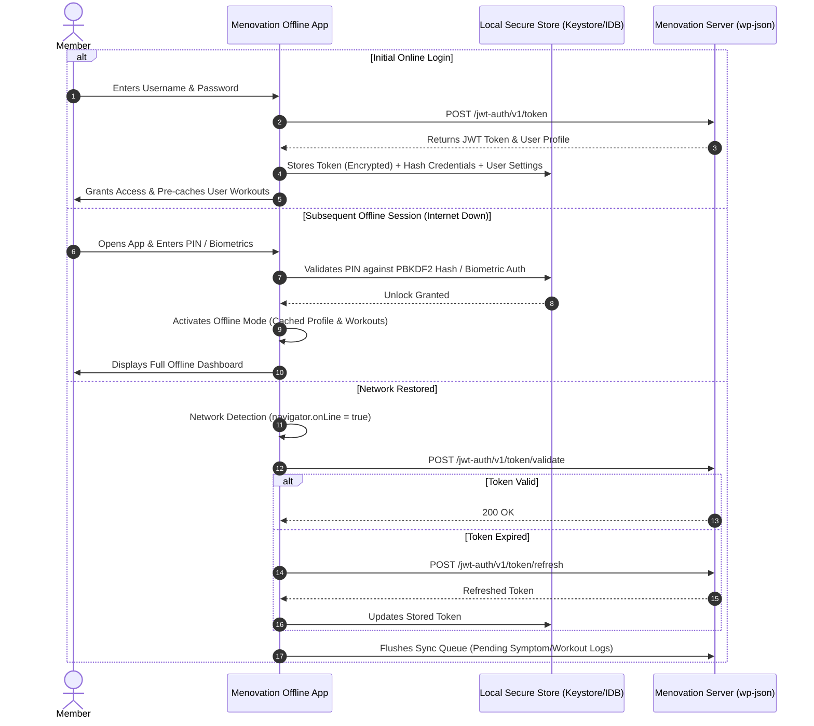

# Menovation Offline Architecture Specification
**Document Version:** 1.0.0  
**Status:** Approved for Implementation  
**Target Systems:** Menovation Offline Webapp (PWA) & Menovation Native Offline App (Mobile & Desktop)

---

## 1. Executive Summary & Vision

Menovation ([menovation.com](https://menovation.com)) provides whole-body strength, wellness, and symptom management for women navigating perimenopause and menopause. The platform provides structured fitness programs (Strength, Pilates, Barre, Yoga, Pelvic Floor, Mobility), cycle and symptom tracking, perimenopause education, and nutritional guidance.

### The Problem
The current platform relies on a cloud-hosted WordPress / MemberPress architecture with server-side rendered pages and remote API dependencies (`https://menovation.com/login/`, `/wp-json/mvn-app/v1/`). When a user encounters network loss—such as during gym basement workouts, airplane or transit travel, rural connectivity dead zones, or server outages—the application fails to load, locking members out of their daily fitness routines and disrupting critical symptom tracking.

### The Objective
Design and implement a **resilient, offline-first application suite**:
1. **Offline Webapp (PWA)**: An installable Progressive Web Application running in modern browsers that functions 100% disconnected from the internet via Service Workers, Cache Storage API, and IndexedDB.
2. **Standalone / Native App**: A cross-platform mobile and desktop application (packaged via Capacitor / Tauri) containing pre-bundled static assets, native biometric authentication, and an embedded SQLite database.

```mermaid
flowchart TD
    subgraph Client["Client Runtime (Offline-First)"]
        UI["UI Layer (Prata + NunitoSans Design System)"]
        Router["Client-Side Router & View Controller"]
        AuthMgr["Offline Auth Manager (Token Cache / PIN / Biometrics)"]
        Storage["Local Storage Layer (IndexedDB / SQLite)"]
        SyncEngine["Bidirectional Sync Engine & Mutation Queue"]
        SW["Service Worker & Cache Storage (PWA)"]
    end

    subgraph Cloud["Menovation Cloud Infrastructure"]
        WpLogin["WordPress / MemberPress (https://menovation.com/login/)"]
        RestApi["WP REST API (/wp-json/mvn-app/v1/)"]
        JwtApi["JWT Auth Endpoint (/wp-json/jwt-auth/v1/token)"]
        CdnMedia["Cloudflare CDN & Media Storage"]
    end

    UI --> Router
    Router --> AuthMgr
    Router --> Storage
    Storage <--> SyncEngine
    UI <--> SW

    SyncEngine -.->|Sync when Online (WebSocket / REST)| RestApi
    AuthMgr -.->|Revalidate Session when Online| JwtApi
    SW -.->|Pre-cache / Stale-While-Revalidate| Cloud
```

---

## 2. Why Menovation Must Work Without Internet

Women's health and wellness routines demand unbroken continuity:

1. **Fitness & Pelvic Floor Continuity in Disconnected Environments**:
   Many fitness activities occur in gyms, hotel basements, studios, or outdoor parks where cellular signals are weak or non-existent. A user ready for a 20-minute pelvic floor or strength session cannot be thwarted by a spinning spinner.
2. **Real-Time, Habit-Forming Symptom Logging**:
   Perimenopause symptoms (hot flashes, palpitations, mood swings, brain fog, sleep disruptions) occur unpredictably throughout the day. If symptom logging requires an internet round-trip, users postpone or abandon entry, leading to lost health records and fragmented clinical insight.
3. **Emergency Disruption Resilience**:
   During network outages, severe weather, or travel, access to health articles, stress-reducing meditation routines, and nutrition guides must remain dependable.
4. **Data Privacy and Latency**:
   Local-first architecture ensures instant zero-latency UI interactions and provides a privacy layer where sensitive hormonal and health data resides safely on-device.

---

## 3. Architecture Comparison: Current vs. Offline-First

| Architectural Dimension | Current Architecture (`https://menovation.com/login/`) | New Offline Webapp & Native App |
| :--- | :--- | :--- |
| **Rendering** | Server-Side PHP / MemberPress templates on WP Engine | Client-Side SPA (Static UI Shell + Reactive State) |
| **Asset Delivery** | Remote CDN / Autoptimize dynamic bundles | Local pre-cached bundles (Service Worker Cache / Native Assets) |
| **Authentication** | Synchronous HTTP POST to `/login/` on every session | Cached JWT token + Encrypted Local PIN / Biometric unlock |
| **Data Storage** | Remote MySQL database only | Local-First IndexedDB / SQLite with background synchronization |
| **Workout Media** | Streamed directly from remote CDN | Tiered caching: essential exercises local, routines downloadable |
| **Offline Behavior** | Complete outage (Browser "No Internet" screen) | Seamless operation with visual "Offline Mode" status indicator |

---

## 4. System Components

### 4.1. Progressive Web App (PWA) Shell
The webapp leverages modern web standards:
- **Service Worker (`sw.js`)**:
  - Implements **Cache-First** strategy for core static assets (HTML, CSS, JS, brand fonts, logos).
  - Implements **Network-First with Cache Fallback** for dynamic API calls.
  - Implements **Stale-While-Revalidate** for updated program definitions.
- **Web App Manifest (`manifest.webmanifest`)**:
  - Defines `display: standalone`, branding icons, theme colors (`#770053`), background color (`#fffef2`), and orientation settings for a native look and feel.
- **Client-Side Storage**:
  - **IndexedDB**: Structured storage for workouts, exercise definitions, user routines, and symptom logs.
  - **Cache Storage API**: Binary storage for CSS, JS, fonts, and image thumbnails.

### 4.2. Standalone Native App Runtime
For native iOS, Android, and Desktop deployments:
- **Engine**: Capacitor or Tauri embedding the offline web assets directly into the binary bundle.
- **Persistence**: Embedded SQLite database (`menovation_offline.db`) via native SQLite drivers.
- **Security**: OS-level Keychain / Android Keystore for cryptographic master key and token storage.
- **Hardware Integration**: Biometric authentication (TouchID, FaceID, BiometricPrompt) without remote network verification.

---

## 5. Offline Authentication & Session Management

The primary hurdle in taking `https://menovation.com/login/` offline is authentication. When the internet is down, an HTTP POST to the server cannot execute.



### Authentication Strategies:
1. **Pre-Authenticated Cached Session**:
   The JWT token received during online login is retained in secure local storage with an expiration timestamp. The app allows full access until the refresh window lapses.
2. **Local PIN / Biometric Re-Authentication**:
   Users can configure an optional 4-digit PIN or enable biometrics. When offline, credentials are authenticated locally without contacting WordPress.
3. **Graceful Offline Fallback ("Guest / Safe Mode")**:
   If a user launches the app completely disconnected without a cached token, the app enters an offline safe mode allowing access to foundational exercises (`core-basics.json`), educational guides, and symptom tracking, saving the data to be assigned to their account upon first online connection.

---

## 6. Local-First Data Storage & Sync Engine

### 6.1. IndexedDB Schema Structure
```
Database: menovation_offline_v1
├── Stores:
│   ├── user_profile (key: userId)
│   ├── programs (key: programPostId)
│   ├── workouts (key: workoutId)
│   ├── exercises (key: exerciseId)
│   ├── symptoms (key: symptomId)
│   ├── daily_logs (key: dateStr "YYYY-MM-DD")
│   ├── articles (key: articleId)
│   ├── nutrition (key: lessonId)
│   └── sync_outbox (autoIncrement: id)
```

### 6.2. The Outbox Mutation Queue (Sync Pattern)
Any offline action (e.g., logging hot flashes in `/mvn-app/v1/symptoms` or adding notes to `/mvn-app/v1/workout-notes`) is written to `sync_outbox` with:
- `id`: Auto-incrementing integer.
- `endpoint`: Target REST API route.
- `method`: `PUT` or `POST`.
- `payload`: Serialized JSON data.
- `timestamp`: Monotonic client UTC timestamp.
- `retryCount`: Integer counter.

When `window.addEventListener('online')` fires:
1. The engine checks network liveness with a lightweight ping to `/wp-json/mvn-app/v1/health-check`.
2. It plays back items in `sync_outbox` in strict FIFO sequence.
3. Successfully acknowledged entries are cleared from `sync_outbox`.
4. In case of conflict, the client applies Last-Write-Wins (LWW) resolution based on the server revision timestamp.

---

## 7. Media & Workout Asset Strategy

Video workouts represent large payloads (100 MB–500 MB per class). Storing all 512 workouts locally would exceed device storage quotas.

### Three-Tier Storage Model:
- **Tier 1: Core App Shell & UI Assets (Pre-bundled / Always Cached)**
  - Size: ~3 MB
  - Scope: Prata and NunitoSans fonts, logos, wordmarks, Dashicons, UI stylesheets, framework scripts, and offline shell.
- **Tier 2: Reference Taxonomy & Static Catalog (Cached on First Run)**
  - Size: ~15 MB
  - Scope: Complete exercise dictionary (`exercises.json`), program listings (`programs.json`), nutrition lessons, menopause stage quizzes, and thumbnail images.
- **Tier 3: Downloadable Workout Media (On-Demand Offline Caching)**
  - Scope: Full workout videos, guided audio meditations, and high-resolution exercise demonstrations.
  - Mechanism: "Download Routine for Offline" button with visual progress bar, storage quota indicator, and user-managed cache eviction.

---

## 8. Implementation Roadmap

1. **Phase 1: Asset Ingestion & Offline Shell (Current Stage)**
   - Download and catalog core brand assets, fonts, stylesheets, scripts, and baseline datasets from `menovation.com`.
   - Implement the offline-ready project structure, manifest, and service worker shell.
2. **Phase 2: Local Storage & Offline UI Implementation**
   - Implement IndexedDB wrapper (`db.js`) and UI components for workouts, symptom tracking, and nutrition guides.
   - Build offline login screen with session caching and local PIN fallback.
3. **Phase 3: Bidirectional Sync Engine**
   - Connect client mutation outbox to `/wp-json/mvn-app/v1/` endpoints.
   - Add conflict resolution and background sync triggers.
4. **Phase 4: Native Packaging & Cross-Platform Testing**
   - Package PWA with Capacitor for iOS and Android app stores.
   - Rigorous testing in airplane mode and simulated network partitions.
