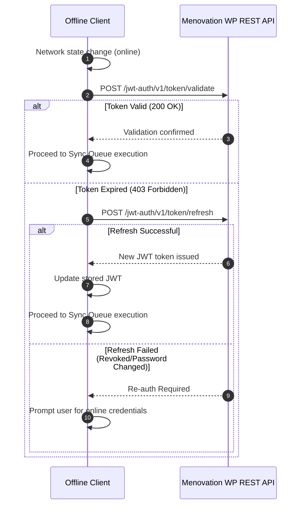

# Menovation Offline Authentication & Data Sync Specification
**Document Version:** 1.0.0  
**Target Architecture:** Local-First Authentication and Outbox Mutation Synchronization  

---

## 1. Overview

Because the existing Menovation authentication flow (`https://menovation.com/login/`) and data storage rely on a centralized WordPress / MemberPress server, disconnection from the internet prevents conventional session verification and data submission. 

This specification establishes:
1. **Offline Authentication Lifecycle**: How members authenticate and unlock their app when disconnected.
2. **Local-First Storage Schema**: How user logs, workouts, and symptom data are persisted locally.
3. **The Outbox Sync Protocol**: How mutations made offline are reliably played back to `/wp-json/mvn-app/v1/` once an internet connection is re-established.

---

## 2. Offline Authentication Lifecycle

### 2.1. Initial Online Setup (First Login)
When the user first logs in while connected to the internet:
1. User submits credentials to `/jwt-auth/v1/token`.
2. Server returns:
   - `token`: Short-lived JWT bearer token (e.g., 7 days validity).
   - `user_email`, `user_nicename`, `user_display_name`.
3. Client fetches the user profile and current routine from `/mvn-app/v1/user-routine-v2`.
4. Client securely persists:
   - Encrypted JWT Token in device secure storage (IndexedDB with Web Crypto API / OS Keystore).
   - Cryptographic salt and hash of an offline PIN (PBKDF2 with 100,000 iterations).
   - User profile and active program subscriptions.

### 2.2. Offline Login & Session Verification (Internet Down)
When the app launches with `navigator.onLine === false` (or network requests time out):
1. The app detects the offline state and presents the **Offline Unlock Screen**.
2. If biometric authentication is available (native app), the app prompts FaceID / TouchID.
3. If using the webapp, the user inputs their 4-to-6 digit Offline PIN.
4. The client hashes the input PIN with the stored salt and verifies against the local hash.
5. Upon match:
   - The user session is initialized in `OFFLINE_MODE`.
   - The user gains full access to downloaded workouts, exercise videos, symptom tracking, and health articles.
   - An "Offline Mode" status banner is displayed indicating that changes are saved locally.

### 2.3. Online Re-Authentication & Token Renewal
When internet connectivity is restored:


---

## 3. Data Synchronization Protocol

### 3.1. The Outbox Mutation Queue Pattern
Every user action that modifies state (logging a symptom, marking a workout complete, adding notes) is treated as an immutable event and written to the `sync_outbox` table in IndexedDB / SQLite:

```json
{
  "id": 1042,
  "clientTimestamp": "2026-10-04T22:20:00Z",
  "endpoint": "/wp-json/mvn-app/v1/symptoms",
  "method": "PUT",
  "payload": {
    "symptomTypeId": 12,
    "severity": 3,
    "logDate": "2026-10-04",
    "notes": "Mild hot flash around 3 PM"
  },
  "status": "pending",
  "retryCount": 0
}
```

### 3.2. Sync Execution Flow
1. **Connectivity Trigger**: Triggered by `online` event, application startup, or manual "Sync Now" tap.
2. **Health Check Ping**: Send a lightweight GET request to `/wp-json/mvn-app/v1/health-check` to verify end-to-end server reachability (distinguishing between local Wi-Fi connectivity and actual internet reachability).
3. **Queue Replay**:
   - Iterate through `sync_outbox` sorted by `id` ASC.
   - Send HTTP request with `Authorization: Bearer <token>`.
   - On HTTP 200/201: Delete mutation from outbox.
   - On HTTP 4xx (client error): Quarantine item to `sync_errors` and notify user if appropriate.
   - On HTTP 5xx (server error) or network timeout: Pause sync and schedule exponential backoff retry.
4. **Pull Server Updates**:
   - Query `/mvn-app/v1/user-routine-v2` and `/mvn-app/v1/symptoms` with `since=<last_sync_timestamp>`.
   - Upsert updated records into local IndexedDB.

### 3.3. Conflict Resolution Strategy
- **Symptom & Workout Logs**: Append-only / additive merge. Multiple offline logs for the same day are merged rather than overwritten.
- **User Settings & Profiles**: Last-Write-Wins (LWW) utilizing UTC timestamps.
- **Notes & Text Fields**: If conflict occurs, server version is retained as primary, and client edits are preserved in a local draft copy.
